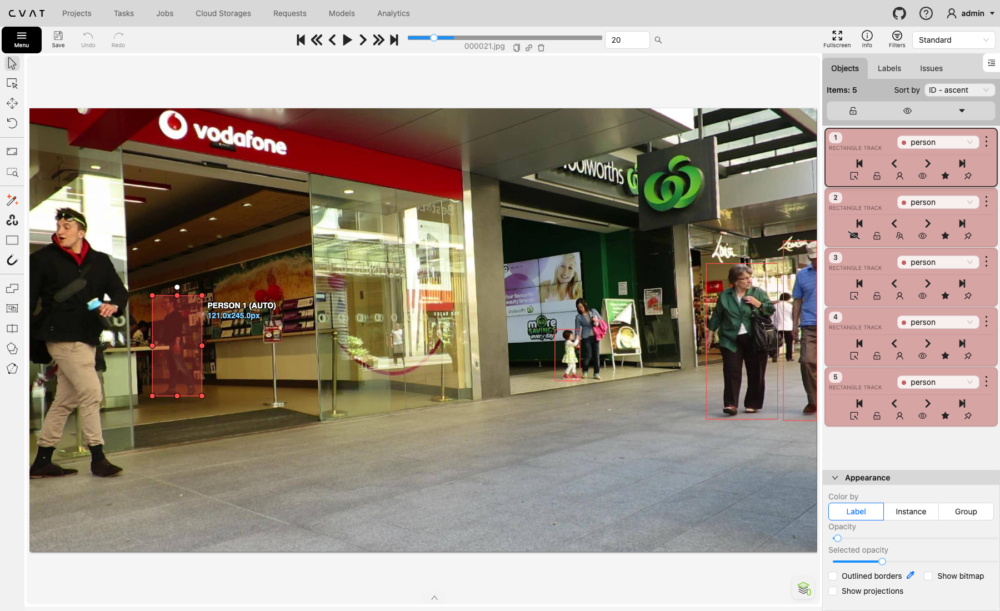
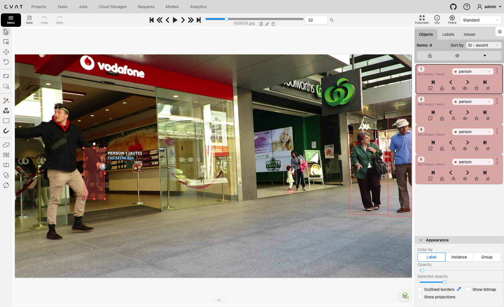
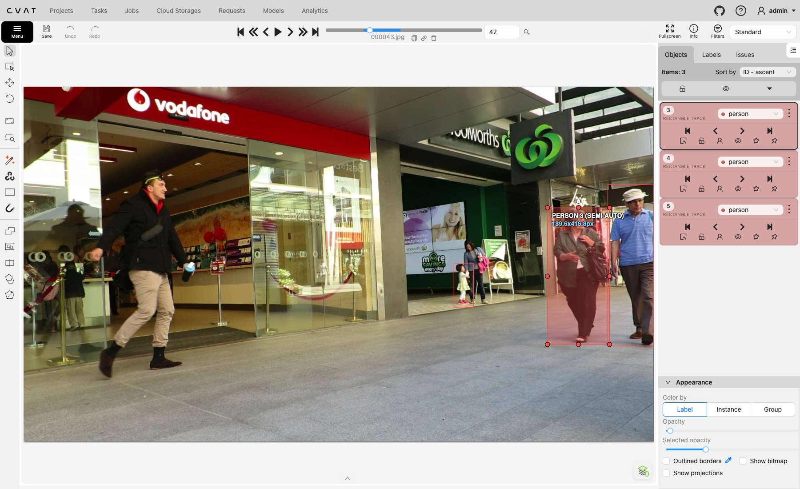

# Báo cáo Lab Day05 — MOT Tracking

## 0. Thông tin học viên

- Họ tên: Trần Xuân Bắc
- MSSV: 2A202603132
- Lớp: L2A
- Mã đề: A
- Email: Bxuan964@gmail.com
- Repository: https://github.com/trxuanbac/K5-L2-DAY05-TranXuanBac-2A202603132-MOTTracking
- Task: `DAY05-MOT17-09-A-2A202603132`
- Job: http://localhost:8080/tasks/19/jobs/19
- Thời gian làm bài: 16:00–19:30, tổng 210 phút. Chưa ghi thời gian riêng từng người hoặc thời gian nghỉ.

Dữ liệu: 150 frame MOT17-09, độ phân giải 1920×1080, 30 FPS. Trong báo cáo dùng số frame CVAT 0–149; trong MOT, frame_id = frame CVAT + 1. Nguồn: MOT17, MOTChallenge (Milan et al., 2016), giấy phép CC BY-NC-SA 3.0.

## 1. Xem trước đoạn video (CP0)

Đề A gồm P1–P5 theo bảng `.lab-local/de-A-P1-P5.jpg`. Bảng dưới tổng hợp phạm vi nhãn hiện đang lưu; không phải nhật ký thời gian lập trước khi vẽ.

| Mã | Frame đầu có box | Frame cuối có box | Đặc điểm và chỗ cần chú ý |
|---|---:|---:|---|
| P1 | 0 | 149 | Người áo đen trong cửa hàng; bị người đi ngang che |
| P2 | 60 | 149 | Người áo sáng trong cửa hàng; bản hiện tại bắt đầu từ frame 60 |
| P3 | 0 | 149 | Người mặc áo xanh lá, mang túi, đi về phía camera |
| P4 | 0 | 149 | Người áo xanh lam đội mũ, đi về phía camera |
| P5 | 0 | 146 | Bé gái ở hậu cảnh; bị hai người phía trước che |

Lấy bảng nhận diện do script tạo làm căn cứ nhận người. Mô tả P2 trong walkthrough có điểm khác bảng đề A: người áo khoác đen đi ngang phía trước là người che khuất, không phải P2 được khoanh trong bảng nhận diện.

Quy ước box: bao toàn thân; khi che một phần vẫn giữ box amodal và bật occluded. Khi mất hẳn thì outside; nếu hiện lại trong 60 frame và chắc chắn cùng người, giữ nguyên ID.

## 2. Keyframe và thời gian (CP1, CP4)

Số keyframe dưới đây lấy từ bản xuất CVAT for video 1.1 và đối chiếu checker. Chỉ đếm keyframe có outside=0, đúng cách tính của script bài học.

| Mã | Số keyframe | Frame keyframe | Số frame có box | KF/100 frame có box | Thời gian |
|---|---:|---|---:|---:|---|
| P1 | 20 | 0, 10, 20, 28, 29, 30, 38, 46, 50, 55, 60, 70, 80, 90, 100, 110, 120, 130, 140, 149 | 143 | 14.0 | Chưa tách riêng |
| P2 | 16 | 60, 70, 79, 80, 90, 100, 110, 120, 129, 130, 139, 140, 141, 145, 146, 149 | 90 | 17.8 | Chưa tách riêng |
| P3 | 16 | 0, 10, 20, 30, 40, 50, 60, 70, 80, 90, 100, 110, 120, 130, 140, 149 | 150 | 10.7 | Chưa tách riêng |
| P4 | 16 | 0, 10, 20, 30, 40, 50, 60, 70, 80, 90, 100, 110, 120, 130, 140, 149 | 150 | 10.7 | Chưa tách riêng |
| P5 | 18 | 0, 10, 20, 30, 40, 50, 60, 70, 80, 90, 100, 105, 110, 111, 134, 138, 140, 144 | 125 | 14.4 | Chưa tách riêng |
| **Tổng** | **86** | — | **658** | **13.1** | **210 phút cả bài** |

P1 có nhiều keyframe được tính nhất vì cần mốc trước khi bị che, khi hiện lại và khi trở lại trạng thái nhìn rõ. Mật độ keyframe của mọi track đều dưới ngưỡng cảnh báo 50/100 frame.

Tên P1–P5 là mã người trong bảng đề. ID trong hai định dạng xuất có thể khác nhau; ánh xạ đã đối chiếu bằng tọa độ box tại frame đầu có mặt:

| Mã người | ID trong CVAT XML | ID trong MOT |
|---|---:|---:|
| P1 | 0 | 1 |
| P2 | 1 | 5 |
| P3 | 2 | 2 |
| P4 | 3 | 3 |
| P5 | 4 | 4 |

## 3. Đoạn bị che (CP2)

Người được kiểm chính: **P1**.

| Mốc | Frame CVAT trong bản nhãn |
|---|---:|
| Bắt đầu bật occluded | 29 |
| Bắt đầu outside | 39 |
| Hiện lại, tắt outside | 46 |
| Tắt occluded | 55 |

P1 không có box ở frame 39–45: 7 frame, tương đương khoảng 0,23 giây. Bản nhãn giữ cùng track khi xuất hiện lại vì khoảng khuất dưới 60 frame, quần áo/dáng người và hướng di chuyển phù hợp trước–sau đoạn che. Bật outside tạm ẩn box, không xóa danh tính người.

P5 cũng có đoạn outside 112–133 và từ 147 đến hết clip. Mốc này cần đối chiếu từng frame quanh ranh giới để bảo đảm không mất box khi vẫn còn thấy một phần người. P2 trong bản mới nhất không có box ở 0–59; cần xác nhận đây là phạm vi đã chọn sau khi xem lại người mục tiêu.

**Ảnh 1 — Trước khi bị che (frame 20)**



**Ảnh 2 — Bị che một phần, occluded (frame 32)**



**Ảnh 3 — Che khuất hoàn toàn, outside (frame 42)**



**Ảnh 4 — Hiện lại với cùng track ID (frame 60)**


Nguồn ảnh: MOT17, MOTChallenge (Milan et al., 2016). Bốn ảnh đã được chụp lại trực tiếp từ trạng thái job 19 hiện tại ngày 13/11/2026, tại các frame 20, 32, 60 và 42. Không sửa nhãn trong bước chụp.

## 4. Tự review ID (CP3)

Tôi đã hoàn thành tự review bản nhãn trên CVAT và sửa lỗi che khuất của bé gái P5. Khi kiểm tra tracking, cần phân biệt lỗi cờ với lỗi danh tính: thay đổi trạng thái nhìn thấy của một người không đồng nghĩa với việc phải tạo ID mới.

Quy trình CP3 của bài gồm hai lượt: đi ngược từ frame 149 về 0 theo từng người, sau đó xem toàn cảnh với bước nhảy 10 frame. Kết quả tự review đã được xác nhận hoàn thành; thứ tự thao tác và lượt phát hiện từng lỗi chưa được ghi riêng.

**Nhật ký lỗi đã xác nhận**

| Frame | Mã người | Loại lỗi | Mô tả | Phát hiện ở lượt | Đã sửa? |
|---|---|---|---|---|---|
| Chưa ghi chính xác | P5 — bé gái | `flag` | Sửa trạng thái che khuất của bé gái; chưa ghi cụ thể lần sửa là `occluded` hay `outside` | Chưa ghi riêng | Có |

Không tự gán một frame cụ thể cho lỗi trên khi chưa có ghi chép. Các mốc 112–133 và từ 147 trở đi trong file hiện tại là đoạn outside của P5, không phải bằng chứng rằng lỗi đã được sửa đúng tại các mốc đó.

**Đối chiếu bản nhãn và file xuất sau review**

Bảng dưới ghi các dữ kiện kiểm được từ hai ZIP và lịch sử snapshot, không tính thành lỗi mới hoặc lỗi do tôi tự phát hiện.

| Frame | Người | Nội dung đối chiếu | Kết quả trong bản hiện tại |
|---|---|---|---|
| 39–46 | P1 | Danh tính trước và sau đoạn che | MOT không có box P1 ở 39–45; từ 46 xuất hiện lại trên cùng track |
| 0–60 | P2 | Thời điểm bắt đầu có box | Bản hiện tại không có box P2 ở 0–59, bắt đầu có từ 60; cần đối chiếu khả năng nhìn thấy người trước mốc này |
| 149 | P3 | Điều chỉnh mép box | Snapshot sau review ghi mép phải đổi từ x=1290 thành khoảng x=1237,9; không có xác nhận riêng để phân loại thành một lỗi `drift` |
| 112–134 | P5 | Khoảng outside và ID khi hiện lại | Không có box ở 112–133; xuất hiện lại từ 134 trên cùng track, khoảng khuất 22 frame dưới ngưỡng 60 frame |
| 147–149 | P5 | Trạng thái cuối clip | Track ở trạng thái outside; cần bảo đảm không còn phần người nhìn thấy trước khi bật cờ này |

**Tổng hợp lỗi**

| `id_switch` | `fragmentation` | `lost` | `merge` | `false_track` | `drift` | `flag` |
|---|---|---|---|---|---|---|
| Chưa có số đếm xác nhận | Chưa có số đếm xác nhận | Chưa có số đếm xác nhận | Chưa có số đếm xác nhận | Chưa có số đếm xác nhận | Chưa có số đếm xác nhận | Ít nhất 1 trường hợp đã sửa: P5 |

Checker sau khi xuất lại báo **5 track ID, 658 box, 0 lỗi và 0 cảnh báo**. Kết quả này xác nhận các điều kiện mà script kiểm được; không thay thế việc xem ảnh và không chứng minh không có ID switch, mất box hoặc box trôi so với ground truth.

**Lỗi chỉ thấy ở lượt xem toàn cảnh**

Chưa có ghi chép xác định lỗi nào chỉ được phát hiện ở lượt 2. Về cách kiểm tra, xem toàn cảnh giúp nhận ra box thiếu/thừa hoặc ID bám sang người khác khi nhiều người che nhau; lượt theo từng người giúp kiểm kỹ sự liên tục và độ sát box. Không quy lỗi che khuất P5 vào một lượt cụ thể khi chưa có thông tin xác nhận.

## 5. File xuất và kết quả tự kiểm (CP4)

| Kiểm tra | Kết quả |
|---|---|
| MOT 1.1 | `src/exports/TranXuanBac_mot.zip` |
| CVAT for video 1.1 | `src/exports/TranXuanBac_cvat_video.zip` |
| Số track ID trong MOT | 5 |
| Tổng box trong MOT | 658 |
| Frame outside có dòng MOT không | Không, theo phạm vi checker đã đọc |
| Trạng thái job tại lần kiểm | `in progress` |

Kết quả checker của bản xuất mới nhất:

```text
Số frame in theo CVAT (bắt đầu từ 0). Trong gt.txt, frame_id = frame CVAT + 1.

=== File MOT 1.1: TranXuanBac_mot.zip ===
  Số track ID: 5   |   Tổng số box: 658
  [OK]        Đúng 5 track ID.

  Track | Frame có mặt | Số frame | Đoạn vắng (outside)
      1 |   0–149      |      143 | 39–45
      2 |   0–149      |      150 | -
      3 |   0–149      |      150 | -
      4 |   0–146      |      125 | 112–133
      5 |  60–149      |       90 | -


=== File CVAT for video 1.1: TranXuanBac_cvat_video.zip ===

  Track | Nhãn   | Frame thấy | Keyframe | KF/100 frame | Frame occluded | Lần bật outside
      0 | person |        143 |       20 |         14.0 |             19 |               1
              Track 0: keyframe ở frame [0, 10, 20, 28, 29, 30, 38, 46, 50, 55, 60, 70, 80, 90, 100, 110, 120, 130, 140, 149]
      1 | person |         90 |       16 |         17.8 |             19 |               0
              Track 1: keyframe ở frame [60, 70, 79, 80, 90, 100, 110, 120, 129, 130, 139, 140, 141, 145, 146, 149]
      2 | person |        150 |       16 |         10.7 |              0 |               0
              Track 2: keyframe ở frame [0, 10, 20, 30, 40, 50, 60, 70, 80, 90, 100, 110, 120, 130, 140, 149]
      3 | person |        150 |       16 |         10.7 |              0 |               0
              Track 3: keyframe ở frame [0, 10, 20, 30, 40, 50, 60, 70, 80, 90, 100, 110, 120, 130, 140, 149]
      4 | person |        125 |       18 |         14.4 |             14 |               2
              Track 4: keyframe ở frame [0, 10, 20, 30, 40, 50, 60, 70, 80, 90, 100, 105, 110, 111, 134, 138, 140, 144]

  Tổng: 86 keyframe / 658 frame có mặt = 13.1 keyframe / 100 frame
  [OK]        Đọc được 5 track từ annotations.xml.

=== Tóm tắt ===
  Lỗi: 0   |   Cảnh báo: 0
  Đạt. Dán phần tóm tắt này vào báo cáo mục 5.
```

Checker chỉ kiểm định dạng và các dấu hiệu nghi ngờ; không có ground truth nên không tính MOTA/IDF1 và không chứng minh mọi box đều đúng.

## 6. Ba câu kết

1. **Nếu gán lại, nên đặt keyframe khác ở đâu?**

   Ưu tiên kiểm các mốc 28–29, 38–39, 45–46 và 54–55 của P1, cùng các mốc 111–112, 133–134 và 146–147 của P5. Đây là nơi thay đổi trạng thái nhìn thấy, cần kiểm từng frame. Với P3/P4 tiến gần camera, nên kiểm giữa hai keyframe ở nửa sau clip và chỉ thêm mốc khi box nội suy trôi rõ, thay vì tăng đều mật độ cho cả đoạn.

2. **Có chỗ nào cần cân nhắc cùng ID hay ID mới?**

   Đoạn P1 mất ở 39–45 và hiện lại ở 46 là trường hợp rõ để áp dụng quy tắc. Khoảng khuất khoảng 0,23 giây, dưới 2 giây; dáng, quần áo và vị trí hiện lại phù hợp nên bản hiện tại giữ cùng ID. P5 mất 22 frame ở 112–133 cũng dưới 60 frame, nhưng vẫn phải đối chiếu ngoại hình và hướng đi, không quyết định chỉ dựa vào thời lượng.

3. **Một lỗi ID ảnh hưởng dự đoán chuyển động và chỉ số thế nào?**

   Nếu ID đang theo P1 chuyển sang người áo khoác đi ngang, vị trí và vận tốc suy ra sẽ nhảy sang người khác; hệ thống có thể dự đoán sai hướng hoặc nguy cơ va chạm. IDF1 phản ánh tính nhất quán danh tính trên chuỗi. MOTA cũng bị ảnh hưởng bởi ID switch cùng FN/FP; không thể kết luận chỉ số nào giảm nhiều hơn nếu chưa có số đếm cụ thể. Đây là tình huống phân tích, chưa phải lỗi ID đã được đo trong job.

## Bonus

Chưa làm B1, B2 hoặc B3; không có kết quả bonus để cộng điểm.

## 7. Tài liệu tham khảo và công cụ AI đã dùng

- Tài liệu bài: docs/GUIDELINE.md, CHECKPOINTS.md, docs/MOT_FORMAT.md, lab_day05_walkthrough và bảng đề A do setup_local_lab.py tạo.
- Dữ liệu: MOT17, MOTChallenge (Milan et al., 2016), CC BY-NC-SA 3.0.
- Codex tạo bản nháp 5 track và các cờ từ quan sát ảnh, nhập nhãn qua API CVAT, xuất file, chạy checker, chụp minh chứng và biên tập báo cáo/ba câu kết. Sau đó đã có thao tác sửa và khôi phục trên CVAT; số liệu trong báo cáo lấy từ bản xuất mới nhất, không dùng lại số liệu cũ. Bản nhãn không phải sản phẩm gán hoàn toàn thủ công. Đã hoàn thành tự review; kết quả lỗi cụ thể còn cần ghi vào mục 4 trước khi hoàn tất báo cáo.
