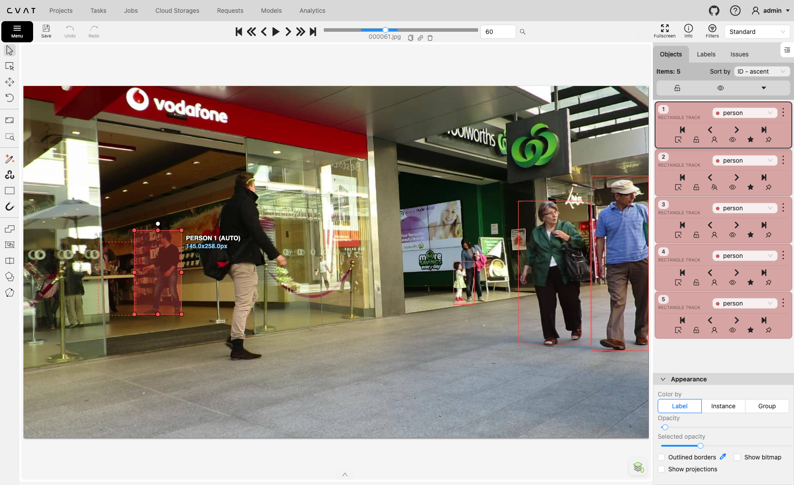

# Báo cáo Lab Day05 — MOT Tracking

## 0. Thông tin học viên

- Họ tên: Trần Xuân Bắc
- MSSV: 2A202603132
- Lớp: L2A
- Mã đề: A
- Email: Bxuan964@gmail.com
- Repository: https://github.com/trxuanbac/K5-L2-DAY05-TranXuanBac-2A202603132-MOTTracking
- Task: `DAY05-MOT17-09-A-2A202603132`
- Job: http://localhost:8080/tasks/19/jobs/19
- Thời gian làm bài: 16:00–19:30, tổng 210 phút. Thời gian từng người và thời gian nghỉ chưa được tách riêng.

Dữ liệu: 150 frame MOT17-09, độ phân giải 1920×1080, 30 FPS. Trong báo cáo dùng số frame CVAT 0–149; trong MOT, frame_id = frame CVAT + 1. Nguồn: MOT17, MOTChallenge (Milan et al., 2016), giấy phép CC BY-NC-SA 3.0.

## 1. Xem trước đoạn video (CP0)

Đề A gồm 5 người P1–P5 trong bảng `.lab-local/de-A-P1-P5.jpg`. Phạm vi nhãn trong file xuất như sau:

| Mã | Frame đầu có box | Frame cuối có box | Đặc điểm và chỗ cần chú ý |
|---|---:|---:|---|
| P1 | 0 | 149 | Người áo đen trong cửa hàng; bị người đi ngang che |
| P2 | 60 | 149 | Người áo sáng trong cửa hàng; bản hiện tại bắt đầu từ frame 60 |
| P3 | 0 | 149 | Người mặc áo xanh lá, mang túi, đi về phía camera |
| P4 | 0 | 149 | Người áo xanh lam đội mũ, đi về phía camera |
| P5 | 0 | 146 | Bé gái ở hậu cảnh; bị hai người phía trước che |

Lấy bảng nhận diện do script tạo làm căn cứ nhận người. Mô tả P2 trong walkthrough có điểm khác bảng đề A: người áo khoác đen đi ngang phía trước là người che khuất, không phải P2 được khoanh trong bảng nhận diện.

Quy ước box: bao toàn thân; khi che một phần vẫn giữ box amodal và bật occluded. Khi mất hẳn thì outside; nếu hiện lại trong 60 frame và chắc chắn cùng người, giữ nguyên ID.

## 2. Keyframe và thời gian (CP1, CP4)

Số keyframe lấy từ file CVAT for video 1.1, chỉ tính những keyframe có `outside=0` theo checker của bài.

| Mã | Số keyframe | Frame keyframe | Số frame có box | KF/100 frame có box | Thời gian |
|---|---:|---|---:|---:|---|
| P1 | 20 | 0, 10, 20, 28, 29, 30, 38, 46, 50, 55, 60, 70, 80, 90, 100, 110, 120, 130, 140, 149 | 143 | 14.0 | Chưa tách riêng |
| P2 | 16 | 60, 70, 79, 80, 90, 100, 110, 120, 129, 130, 139, 140, 141, 145, 146, 149 | 90 | 17.8 | Chưa tách riêng |
| P3 | 16 | 0, 10, 20, 30, 40, 50, 60, 70, 80, 90, 100, 110, 120, 130, 140, 149 | 150 | 10.7 | Chưa tách riêng |
| P4 | 16 | 0, 10, 20, 30, 40, 50, 60, 70, 80, 90, 100, 110, 120, 130, 140, 149 | 150 | 10.7 | Chưa tách riêng |
| P5 | 18 | 0, 10, 20, 30, 40, 50, 60, 70, 80, 90, 100, 105, 110, 111, 134, 138, 140, 144 | 125 | 14.4 | Chưa tách riêng |
| **Tổng** | **86** | — | **658** | **13.1** | **210 phút cả bài** |

P1 có nhiều keyframe được tính nhất vì cần mốc trước khi bị che, khi hiện lại và khi trở lại trạng thái nhìn rõ. Mật độ keyframe của mọi track đều dưới ngưỡng cảnh báo 50/100 frame.

P1–P5 là mã người trong đề. Bảng dưới dùng để đối chiếu ID giữa hai file xuất:

| Mã người | ID trong CVAT XML | ID trong MOT |
|---|---:|---:|
| P1 | 0 | 1 |
| P2 | 1 | 5 |
| P3 | 2 | 2 |
| P4 | 3 | 3 |
| P5 | 4 | 4 |

## 3. Đoạn bị che (CP2)

Người được kiểm chính: **P1**.

| Mốc | Frame CVAT trong bản nhãn |
|---|---:|
| Bắt đầu bật occluded | 29 |
| Bắt đầu outside | 39 |
| Hiện lại, tắt outside | 46 |
| Tắt occluded | 55 |

P1 không có box ở frame 39–45: 7 frame, tương đương khoảng 0,23 giây. Bản nhãn giữ cùng track khi xuất hiện lại vì khoảng khuất dưới 60 frame, quần áo/dáng người và hướng di chuyển phù hợp trước–sau đoạn che. Bật outside tạm ẩn box, không xóa danh tính người.

P5 có hai đoạn outside: 112–133 và 147–149. Cần xem kỹ frame trước và sau mỗi đoạn để tránh ẩn box quá sớm. Với P2, file hiện tại bắt đầu có box từ frame 60; đoạn trước đó vẫn cần kiểm tra lại.

**Ảnh 1 — Trước khi bị che (frame 20)**


**Ảnh 2 — Bị che một phần, occluded (frame 32)**


**Ảnh 3 — Che khuất hoàn toàn, outside (frame 42)**


**Ảnh 4 — Hiện lại với cùng track ID (frame 60)**



Nguồn ảnh: MOT17, MOTChallenge (Milan et al., 2016). Ảnh chụp trực tiếp từ job 19 ngày 13/11/2026, tại frame 20, 32, 42 và 60.

## 4. Tự review ID (CP3)

Tôi đã review lại nhãn trên CVAT và sửa lỗi che khuất của bé gái P5. Ở đoạn này, cần phân biệt lúc còn thấy một phần người với lúc mất hẳn để chọn đúng `occluded` hoặc `outside`, đồng thời giữ nguyên track ID khi bé xuất hiện lại.

**Lỗi đã sửa**

| Người | Mã lỗi | Nội dung | Đã sửa? |
|---|---|---|---|
| P5 — bé gái | `flag` | Sửa cờ che khuất | Có |

Các mốc của P5 trong bản nhãn sau review:

| Frame | Trạng thái |
|---|---|
| 105–111 | Bị che một phần, bật `occluded` |
| 112–133 | Mất hẳn, bật `outside` |
| 134–137 | Hiện lại nhưng còn bị che, tắt `outside` và giữ `occluded` |
| 138–143 | Tắt `occluded` |
| 144–146 | Bật lại `occluded` |
| 147–149 | Bật `outside` |

Đây là các mốc đọc từ file xuất. Tôi chưa ghi riêng frame đã thao tác sửa và lượt phát hiện lỗi.

**Đối chiếu sau review**

| Người | Frame | Kết quả |
|---|---|---|
| P1 | 39–46 | Không có box ở 39–45; hiện lại từ 46 với cùng ID |
| P2 | 0–60 | Box bắt đầu ở 60; cần kiểm lại xem có bỏ sót phần người còn thấy trước đó không |
| P3 | 149 | Mép phải box đã được chỉnh từ x=1290 xuống khoảng x=1237,9 |
| P5 | 112–134 | Khuất 22 frame, sau đó hiện lại trên cùng track |
| P5 | 147–149 | Track ở trạng thái outside đến hết clip |

Tôi đã ghi nhận và sửa một trường hợp `flag` ở P5. Các loại lỗi khác chưa có thống kê riêng, nên chưa ghi số 0 cho toàn bộ job.

**Nhận xét về hai cách review**

Review theo từng người giúp kiểm tra box có bám liên tục và ID có giữ đúng người không. Xem toàn cảnh giúp nhận ra box thiếu, box thừa hoặc ID nhảy sang người khác khi các đối tượng che nhau. Tôi chưa ghi lỗi P5 được phát hiện ở lượt nào.

Sau khi xuất lại, checker báo **5 track ID, 658 box, 0 lỗi và 0 cảnh báo**.

## 5. File xuất và kết quả tự kiểm (CP4)

| Kiểm tra | Kết quả |
|---|---|
| MOT 1.1 | `src/exports/TranXuanBac_mot.zip` |
| CVAT for video 1.1 | `src/exports/TranXuanBac_cvat_video.zip` |
| Số track ID trong MOT | 5 |
| Tổng box trong MOT | 658 |
| Frame outside có dòng MOT không | Không |
| Trạng thái job tại lần kiểm | `in progress` |

Kết quả checker của bản xuất mới nhất:

```text
Số frame in theo CVAT (bắt đầu từ 0). Trong gt.txt, frame_id = frame CVAT + 1.

=== File MOT 1.1: TranXuanBac_mot.zip ===
  Số track ID: 5   |   Tổng số box: 658
  [OK]        Đúng 5 track ID.

  Track | Frame có mặt | Số frame | Đoạn vắng (outside)
      1 |   0–149      |      143 | 39–45
      2 |   0–149      |      150 | -
      3 |   0–149      |      150 | -
      4 |   0–146      |      125 | 112–133
      5 |  60–149      |       90 | -


=== File CVAT for video 1.1: TranXuanBac_cvat_video.zip ===

  Track | Nhãn   | Frame thấy | Keyframe | KF/100 frame | Frame occluded | Lần bật outside
      0 | person |        143 |       20 |         14.0 |             19 |               1
              Track 0: keyframe ở frame [0, 10, 20, 28, 29, 30, 38, 46, 50, 55, 60, 70, 80, 90, 100, 110, 120, 130, 140, 149]
      1 | person |         90 |       16 |         17.8 |             19 |               0
              Track 1: keyframe ở frame [60, 70, 79, 80, 90, 100, 110, 120, 129, 130, 139, 140, 141, 145, 146, 149]
      2 | person |        150 |       16 |         10.7 |              0 |               0
              Track 2: keyframe ở frame [0, 10, 20, 30, 40, 50, 60, 70, 80, 90, 100, 110, 120, 130, 140, 149]
      3 | person |        150 |       16 |         10.7 |              0 |               0
              Track 3: keyframe ở frame [0, 10, 20, 30, 40, 50, 60, 70, 80, 90, 100, 110, 120, 130, 140, 149]
      4 | person |        125 |       18 |         14.4 |             14 |               2
              Track 4: keyframe ở frame [0, 10, 20, 30, 40, 50, 60, 70, 80, 90, 100, 105, 110, 111, 134, 138, 140, 144]

  Tổng: 86 keyframe / 658 frame có mặt = 13.1 keyframe / 100 frame
  [OK]        Đọc được 5 track từ annotations.xml.

=== Tóm tắt ===
  Lỗi: 0   |   Cảnh báo: 0
  Đạt. Dán phần tóm tắt này vào báo cáo mục 5.
```

Checker kiểm định dạng và dấu hiệu bất thường. Chất lượng box và ID vẫn cần xem bằng mắt; MOTA/IDF1 cần được tính với ground truth.

## 6. Ba câu kết

1. **Nếu gán lại, nên đặt keyframe khác ở đâu?**

   Ưu tiên kiểm các mốc 28–29, 38–39, 45–46 và 54–55 của P1, cùng các mốc 111–112, 133–134 và 146–147 của P5. Đây là nơi thay đổi trạng thái nhìn thấy, cần kiểm từng frame. Với P3/P4 tiến gần camera, nên kiểm giữa hai keyframe ở nửa sau clip và chỉ thêm mốc khi box nội suy trôi rõ, thay vì tăng đều mật độ cho cả đoạn.

2. **Có chỗ nào cần cân nhắc cùng ID hay ID mới?**

   Đoạn P1 mất ở 39–45 và hiện lại ở 46 là trường hợp rõ để áp dụng quy tắc. Khoảng khuất khoảng 0,23 giây, dưới 2 giây; dáng, quần áo và vị trí hiện lại phù hợp nên bản hiện tại giữ cùng ID. P5 mất 22 frame ở 112–133 cũng dưới 60 frame, nhưng vẫn phải đối chiếu ngoại hình và hướng đi, không quyết định chỉ dựa vào thời lượng.

3. **Một lỗi ID ảnh hưởng dự đoán chuyển động và chỉ số thế nào?**

   Nếu ID đang theo P1 chuyển sang người áo khoác đi ngang, vị trí và vận tốc suy ra sẽ nhảy sang người khác; hệ thống có thể dự đoán sai hướng hoặc nguy cơ va chạm. IDF1 phản ánh tính nhất quán danh tính trên chuỗi. MOTA cũng bị ảnh hưởng bởi ID switch cùng FN/FP; không thể kết luận chỉ số nào giảm nhiều hơn nếu chưa có số đếm cụ thể. Ví dụ này giải thích hậu quả của lỗi ID, không phải kết quả đo lỗi trong job.

## Bonus

Chưa làm B1, B2 hoặc B3; không có kết quả bonus để cộng điểm.

## 7. Tài liệu tham khảo và công cụ AI đã dùng

- Tài liệu bài: docs/GUIDELINE.md, CHECKPOINTS.md, docs/MOT_FORMAT.md, lab_day05_walkthrough và bảng đề A do setup_local_lab.py tạo.
- Dữ liệu: MOT17, MOTChallenge (Milan et al., 2016), CC BY-NC-SA 3.0.
- Codex hỗ trợ viết báo cáo, gồm phần phân tích ở mục 6. Tôi đã review lại và sửa lỗi che khuất của P5. Số liệu trong báo cáo lấy từ bản xuất sau các chỉnh sửa.
